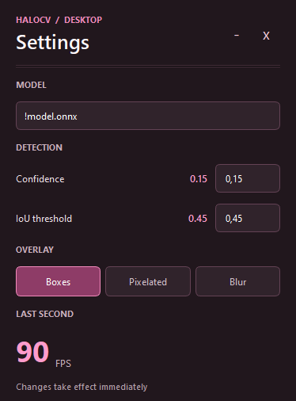

<div align="center">

[](https://www.python.org/)
[](https://pypi.org/project/onnxruntime/)
[](https://github.com/ultralytics/ultralytics)
[](https://pypi.org/project/PySide6/)
[](https://github.com/ra1nty/DXcam)
[](https://github.com/xxivyy/HaloCV/blob/main/LICENSE)

### [About](#about) • [Requirements](#requirements) • [Desktop Tool](#desktop-tool) • [Python Module](#python-module) • [Roadmap](#roadmap) • [License](#license)

### HaloCV

#### A computer vision toolkit for Ultralytics YOLO ONNX models.



</div>

## About

...

## Requirements

HaloCV requires [`uv`](https://docs.astral.sh/uv/) and runs on Python 3.12 or later.

You need a compatible Ultralytics detection model exported to ONNX format.
The model must include the Ultralytics metadata, HaloCV reads `author`, `task`, `imgsz`, and `names`.

The default dependencies include a GPU enabled ONNX Runtime and PyTorch. The ONNX Runtime session is configured to use CUDA when available and fall back to CPU. GPU execution requires a compatible NVIDIA driver.

From the repository root, sync the environment:

```cmd
uv sync
```

To use the desktop tool, also add the `desktop` group or run `!desktop_setup.bat`:

```cmd
uv sync --group desktop
```

## Desktop Tool

...

## Python Module

### Quickstart

```python
import cv2

from halocv import HaloCV

model = HaloCV("path/to/model.onnx")

image = cv2.imread("path/to/image.png")

if image is not None:
    image = cv2.cvtColor(image, cv2.COLOR_BGR2RGB)

    detections = model.detect(frame=image, conf=0.55, iou=0.45)

    for d in detections:
        print(d)
```

If the image is already loaded as `RGB`, you can skip `cv2.cvtColor`. For example when using `Pillow`.

Each detection will have this shape:

```python
{
    "cls": "class_label",
    "score": 0.75,  # confidence float, 0-1.
    "box": (x, y, width, height),  # pixel coordinates.
}
```

### Optimizing

Images larger than the model input are downscaled internally. By default, returned boxes will be based on the resolution of the `frame` passed to `detect`. 

If your image resolution stays constant, you can avoid the temporary buffer allocation on each call by resizing on your own and passing `box_resolution` with the original `(width, height)`, which will make the returned boxes be based on that resolution instead.

Using a scale is important because HaloCV uses letterboxing to preserve the images aspect ratio.

Example:

```python
original_h, original_w = image.shape[:2]

scale = min(
    1.0,
    model.input_height / original_h,
    model.input_width / original_w,
)

input_h = max(1, round(original_h * scale))
input_w = max(1, round(original_w * scale))

buffer = np.empty(
    (input_h, input_w, 3),
    dtype=np.uint8,
)

cv2.resize(
    src=image,
    dsize=(input_w, input_h),
    dst=buffer,
    interpolation=cv2.INTER_AREA,
)

detections = model.detect(
    frame=buffer,
    conf=0.55,
    iou=0.45,
    box_resolution=(input_w, input_h),
)
```

## Roadmap

#### Features which could be added in the future:

### HaloCV

- Release to PyPI.
- Add threadsafety or internal threading.
- Add box smoothing & tracking.

### Desktop Tool

- Add available classes and allow disabling them individually.
- Add class label and score to boxes.
- Add auto reload to the model directory.
- Add settings for box color & thickness.
- Add settings for pixelation & blur strength.
- Add linux support. (?)

## License

This project is licensed under the GNU Affero General Public License v3.0. See [LICENSE](LICENSE).
